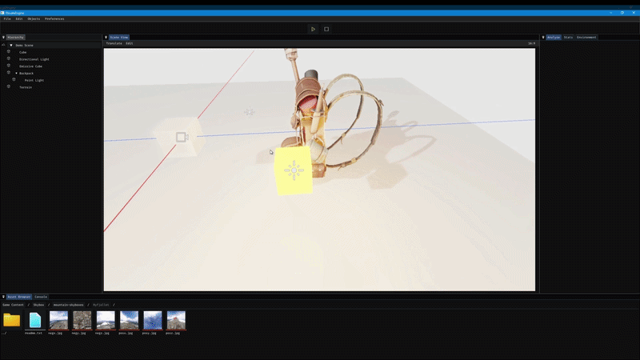

<p align="center">
  
  <br/>
  
</p>

# Web Build Demo

Editor and Runtime emscripten builds are automatically deployed on the gh-page branch. Here is a list of deployed projects :

| Project  | Configuration  | Link                                                                               |
| :------- | :------------- | :--------------------------------------------------------------------------------- |
| Launcher | Release        | [Launcher](https://justinfiset.github.io/Elevate-Engine/runtime/Elevate-Launcher/) |
| Sandbox  | Release        | [Sandbox](https://justinfiset.github.io/Elevate-Engine/runtime/Sandbox/)           |
| Sandbox  | Editor_Release | [Sandbox Editor](https://justinfiset.github.io/Elevate-Engine/editor/Sandbox/)     |

# Project Setup and Usage Guide

## Requirements

- CMake 3.28 or newer
- Ninja 1.11 or newer
- A C++20 compiler with native module scanning:
  - Clang 16 or newer
  - GCC 15 or newer
  - MSVC 14.34 or newer
  - Emscripten with `emscan-deps`

## Download the Project

```cmd
git clone --recurse-submodules https://github.com/justinfiset/Elevate-Engine
cd Elevate-Engine
```

If the repository was cloned without submodules:

```cmd
git submodule update --init --recursive
```

## Configure and Build

CMake Presets configure Ninja Multi-Config builds for every supported platform.

### Windows / MSVC

```cmd
cmake --preset windows-msvc
cmake --build Build/windows-msvc --config Editor_Debug
ctest --test-dir Build/windows-msvc -C Editor_Debug --output-on-failure
```

### Visual Studio 2022

The Visual Studio 2022 generator is a supported local development path:

```cmd
cmake --preset visual-studio-2022
```

Open `Build/visual-studio-2022/ElevateEngine.sln` and build the `Sandbox` startup project. `visual-studio-2026` is also available when Visual Studio 2026 is installed; that preset requires CMake 4.2 or newer. CI uses the Ninja Multi-Config presets and explicitly selects `cl.exe` for the Windows jobs.

### VS Code

For VS Code with CMake Tools and the Microsoft C/C++ extension, use the Ninja preset:

```cmd
cmake --preset windows-msvc
```

CMake writes `Build/windows-msvc/compile_commands.json` during configure. CMake Tools can feed its IntelliSense configuration directly from the CMake project, so a compilation database is not strictly required for that setup.

If you use clangd, point it at the generated database:

```json
{
  "clangd.arguments": [
    "--compile-commands-dir=${workspaceFolder}/Build/windows-msvc"
  ]
}
```

The Visual Studio generator does not emit `compile_commands.json`; CMake only supports that with Makefile and Ninja generators.

### Linux / Clang

```bash
cmake --preset linux-clang
cmake --build Build/linux-clang --config Editor_Debug -j"$(nproc)"
ctest --test-dir Build/linux-clang -C Editor_Debug --output-on-failure
```

### Linux / GCC

```bash
cmake --preset linux-gcc
cmake --build Build/linux-gcc --config Editor_Debug -j"$(nproc)"
ctest --test-dir Build/linux-gcc -C Editor_Debug --output-on-failure
```

### Web / Emscripten

Set up the [emsdk](https://emscripten.org/docs/getting_started/downloads.html) first, then:

```bash
cmake --preset web
cmake --build Build/web --config Release
```

The preset uses the Emscripten toolchain directly, so `emcmake` is not required and can override the generated build system.

## Configurations

The available configurations are:

- `Editor_Debug`
- `Editor_Release`
- `Debug`
- `Release`
- `Dist`

Executables and libraries are written to:

```text
Build/bin/<Configuration>-<Platform>-<Architecture>/<Target>
```

For example:

```text
Build/bin/Editor_Debug-windows-x86_64/ElevateEngine-Tests/ElevateEngine-Tests.exe
```

## Wwise

Wwise integration is optional. It is enabled automatically when `WWISESDK` points to a valid SDK, or explicitly with:

```bash
cmake --preset linux-clang -DEE_ENABLE_WWISE=ON
```

Disable it with `-DEE_ENABLE_WWISE=OFF`.

## Resources

Embedded resource modules are generated during CMake configuration. Run the `resourcegen` target to force regeneration:

```bash
cmake --build Build/linux-clang --target resourcegen
```

## Build Status

CI builds and tests every supported compiler: Clang and GCC on Linux, MSVC on Windows, and Emscripten for WebAssembly. The Windows CI job uses the MSVC toolchain with Ninja Multi-Config; the Visual Studio 2022 generator is supported for local development.

| Platform                                                                                                    | OS                          | Compiler              | Status                                                                                                                                                                                         |
| :---------------------------------------------------------------------------------------------------------- | :-------------------------- | :-------------------- | :--------------------------------------------------------------------------------------------------------------------------------------------------------------------------------------------- |
|              | `windows-latest`            | MSVC (Ninja)          | [](https://github.com/justinfiset/Elevate-Engine/actions)   |
|                    | `ubuntu-24.04`              | Clang 18 (Ninja)      | [](https://github.com/justinfiset/Elevate-Engine/actions) |
|                    | `ubuntu-24.04`              | GCC 15 (Ninja)        | [](https://github.com/justinfiset/Elevate-Engine/actions) |
|  | `emscripten` (Windows Host) | Emscripten (Ninja)    | [](https://github.com/justinfiset/Elevate-Engine/actions)             |

## Tests Report

[](https://justinfiset.github.io/Elevate-Engine/tests/)
